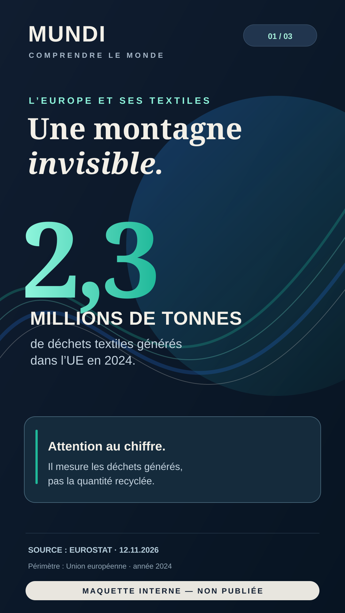
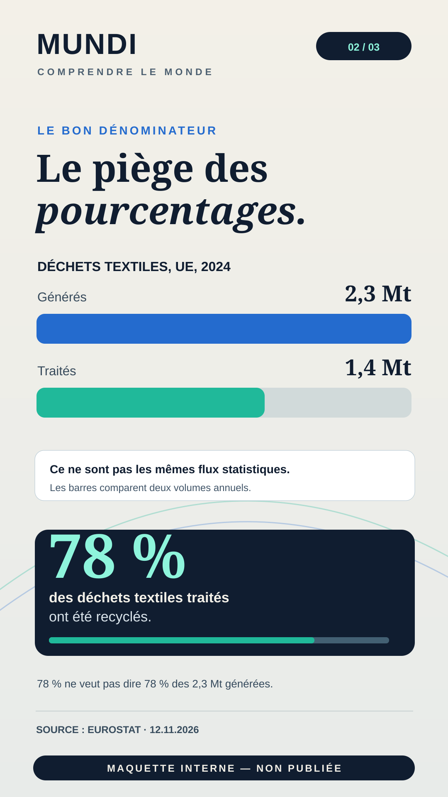
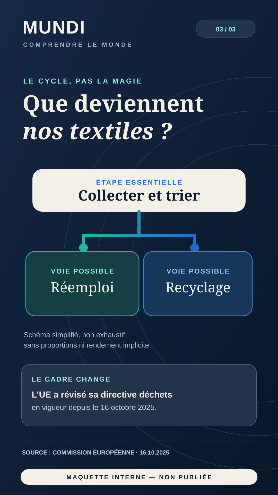

# MUNDI — Direction artistique des infographies · proposition V1

**État : maquettes internes à valider par le fondateur.** Ne jamais copier ces fichiers dans `public/`, le fil MUNDI ou les pages de publication tant que les chiffres et les visuels n'ont pas obtenu de validation éditoriale. Ces fichiers SVG sont originaux : ils ne reprennent aucune photographie, graphique ni illustration tiers.

## Les trois propositions, 1080 × 1920 (9:16)

### 01 — Le chiffre qui frappe

**Objectif :** partir d'un seul nombre avec son unité, sa période, son périmètre géographique et son sens statistique. Préférer une typographie expressive à des icônes décoratives.

### 02 — La différence entre des dénominateurs

**Objectif :** montrer simultanément deux quantités à la même échelle (2,3 Mt générées ; 1,4 Mt traitées) et **un autre indicateur séparé** (78 % des déchets *traités* recyclés). Les barres sont proportionnelles à leurs propres valeurs, mais les deux quantités annuelles ne sont pas nécessairement les étapes suivies d'un même lot de déchets. Ce point est explicite sur la maquette.

### 03 — Le mécanisme, sans schéma trompeur

**Objectif :** raconter une logique (« collecte et tri » puis plusieurs issues possibles) sans prétendre représenter toutes les filières ni leurs taux réels. Le contexte réglementaire est une information distincte.

## Décisions de conception

- **Signature MUNDI :** fonds marine profonds, crème/ivoire, vert menthe pour les idées révélées, bleu pour les volumes généraux, Fraunces pour les idées centrales et DM Sans pour les faits, les unités et les sources.
- **Information avant décoration :** jamais de dénominateur caché, d'axe tronqué, d'échelle 3D, de données dessinées sans unité ou de couleur employée comme seul canal d'information.
- **Composition :** accroche en partie supérieure ; signal statistique/mécanisme au centre ; explication/caveat en bas ; source, période et statut au pied. Garder 80–90 px de marge latérale sur un canevas 1080.
- **Pas de texte essentiel dans une image générée :** les versions de production doivent être bâties en composants React/SVG ou HTML/CSS avec texte accessible, données typées et provenance. Les SVG sont des **maquettes de composition et de style**, pas des cartes prêtes à publier.
- **Motion :** transitions discrètes (opacité/déplacement jusqu'à 30 px ; 350 ms), jamais de mouvement nécessaire pour comprendre, `prefers-reduced-motion` respecté ; pas d'animation qui modifie l'échelle ou laisse entendre un effet causal non mesuré.
- **Accessibilité :** contraste AA, textes alternatifs explicatifs, unités et chiffres lisibles par lecteurs d'écran, sources ouvrables au clavier, alternative textuelle aux motifs décoratifs.
- **Licence et faits :** les chiffres proviennent du dossier interne `editorial/reviews/textile-2024/`, encore **non approuvé**. La reproduction de graphiques, photos ou données tierces impose une vérification des droits. Tout usage public exige un contrôle humain préalable.
- **Validation :** le fondateur approuve le style ; l'équipe éditoriale approuve les chiffres et leur dénominateur ; Claude Code convertit la maquette retenue en composants réutilisables et testés, **sans afficher ce pilote dans le fil public**.

## Contrat pour Claude Code (issue #25)

Le style est défini ici et dans `tokens.json`. Construire des composants `StatCard`, `ComparisonCard` et `ExplanationCard` pouvant recevoir des **données externes validées** : ne pas prendre les nombres codés en dur dans ces maquettes comme source de vérité. Leur intégration doit se faire dans le fil uniquement pour une publication déjà approuvée ; le Studio présente un aperçu toujours étiqueté **« Brouillon — non publié »**. En cas de données manquantes, afficher une alternative textuelle explicite plutôt qu'un graphique approximatif.

## Références éditoriales à contrôler

- Eurostat, [2.3 million tonnes of textile waste generated in 2024](https://ec.europa.eu/eurostat/en/web/products-eurostat-news/w/ddn-20261112-1) (12 novembre 2026).
- Commission européenne, [Revised Waste Framework Directive enters into force](https://environment.ec.europa.eu/news/revised-waste-framework-directive-enters-force-2025-10-16_en) (16 octobre 2025).
- Checklist de relecture : `editorial/reviews/textile-2024/fact-check.md`.

**Important :** maquettes à vocation de revue graphique uniquement, non validées pour une publication.
