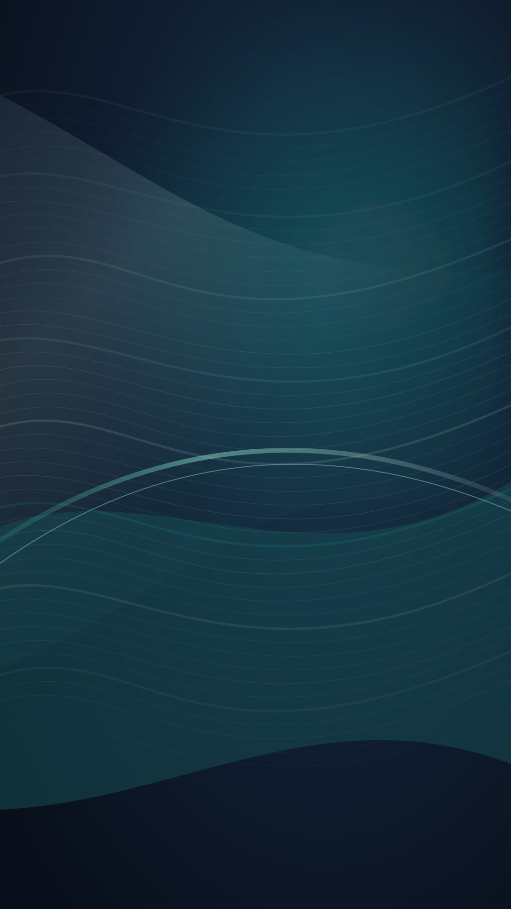
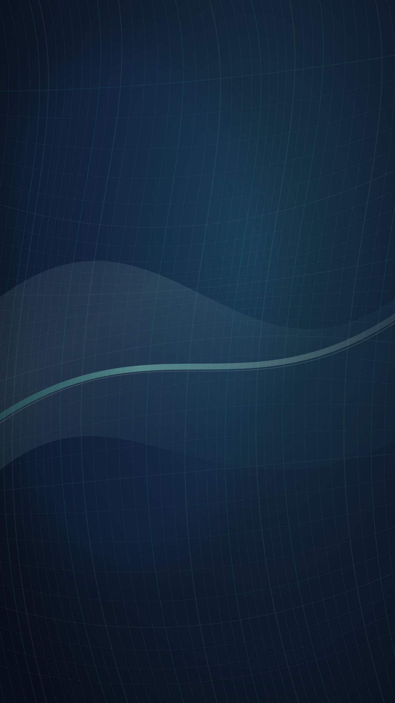
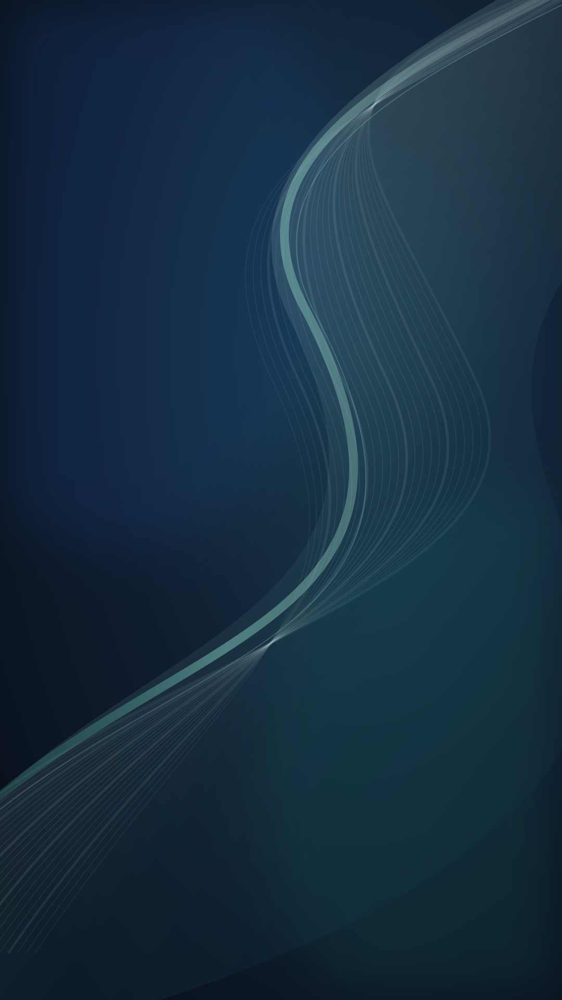

# MUNDI — Direction artistique V2 : **l'information devient une scène**

> **Prototype graphique interne / à approuver.** Zéro chiffre ou texte dans les illustrations. Les images sont des décors originaux ; les données et sources apparaissent uniquement dans le DOM, depuis la publication vérifiée. Aucun des fichiers ici ne se trouve dans le site public.

## Ce qui change après le retour du fondateur

Nous abandonnons les maquettes précédentes de « cartes » trop arrondies et les compositions agressives évoquant des affiches de sport. La direction visée est **un média digital culturel et cinématographique**, mêlant énergie du scroll TikTok, sobriété des interfaces sociales et précision d'un magazine. Une composition apparaît à chaque geste, plutôt qu'une collection de panneaux génériques.

- **Plein écran :** l'image et la texture sont un espace narratif, pas une vignette collée dans un rectangle.
- **Typographie :** DM Sans ou sans-serif expressive pour l'essentiel. Une légère intervention *Fraunces italic* sur un mot pour produire un contraste éditorial ; jamais de lettrages criards ou compressés.
- **Rythme :** texte dense mais respirant, interlignage serré (titres 0,92), césure et alignements intentionnels. Pas de trois blocs géants éloignés les uns des autres.
- **Interface silencieuse :** MUNDI, progression discrète, gestes et source. Les interactions ne recouvrent pas la narration.
- **Couleurs :** marine nocturne, ivoire, menthe subtile et lumière bleutée ; moins de néons, plus de matière et de profondeur.
- **Animation :** défilement vertical natif, révélations de mots au scroll, léger mouvement d'arrière-plan, transitions opportunes ; réduire à un écran statique cohérent en cas de préférence de mouvement réduit.
- **Références :** aucune source d'image externe ni chiffre de démonstration incrusté dans les textures.

## Trois décors originaux, sans aucune donnée chiffrée

### A — La matière

Des plis et des lignes fibres apparaissent derrière une accroche courte. Le nombre éventuel serait **un élément HTML natif**, distinct du fond, après vérification éditoriale.

### B — Les trames

Un tissage graphique sobre pour accompagner une comparaison exacte, qui reste faite par les composants `DataCardView`. Ces fils sont décoratifs : **ils ne représentent aucune valeur**.

### C — Les flux

Des trajectoires visuelles pour introduire une explication ; **elles ne constituent pas une flèche causale ni un diagramme de conversion**. Les alternatives réelles doivent être expliquées par les étapes typées `layout: alternatives`.

## Prototype animé — vision du comportement

**Fichier :** [motion-lab.html](motion-lab.html) (laboratoire autonome, sans publication).

Le fichier HTML est **autonome** (ses trois décors SVG sont intégrés dans le fichier, sans réseau ni dépendances). Dans GitHub, ouvrir `motion-lab.html`, choisir **Download raw file**, puis ouvrir le fichier téléchargé dans Safari, Chrome ou Firefox pour expérimenter les gestes, le scroll vertical, les progressions, l'apparition typographique et l'animation des décors. L'interface se parcourt au toucher, à la molette, via les boutons « Continuer » et avec les flèches haut/bas. Le bouton Pause et `prefers-reduced-motion` préservent une lecture statique.

Les textes du laboratoire ne prétendent **pas** documenter un événement réel : ce sont des textes de démonstration éditoriale.

## Handoff pour Claude Code — intégrer la beauté sans sacrifier les faits

Les PR #28 et #29 ont fourni la **structure typée** des cartes et les contrôles d'accessibilité. Pour le travail de finition :

1. Ne pas mettre ces SVG verticaux dans le slot `visual` limité à 14 rem, qui est réservé à des illustrations complémentaires. Ils sont prévus pour une **couche d'ambiance plein écran** derrière le contenu (si le fondateur approuve).
2. Garder tous les chiffres, comparaisons, dénominateurs, unités, dates, sources et légendes sous forme **HTML/SVG natif de données**. Ne jamais extraire du texte de l'image ni figer des statistiques dans un fond graphique.
3. Passer du langage « boîte + bordure arrondie » à **une composition typographique sur fond visuel**. Les seuls contours visibles devraient être utilitaires (focus, navigation, états) et non une grille de rectangles.
4. N'animer que la scène active, sans interrompre les lecteurs d'écran, sans animation des montants qui pourrait suggérer de faux chiffres et en respectant `prefers-reduced-motion`.
5. Préserver la visibilité des sources et les étiquettes « Brouillon — non publié » dans MUNDI Studio ; ne pas diffuser les données du dossier textile sans validation humaine.
6. Une vidéo/photographie tierce est admissible seulement après vérification de ses droits. Ces SVG sont des fonds originaux de prototype et n'ajoutent aucun droit de presse.

**Intégration :** proposer sur une branche séparée et tester sur mobile/desktop. Ne pas copier automatiquement dans `public/` avant approbation visuelle du fondateur.

## Essai du motion design : ce qu'il faut vérifier

- Un seul geste de swipe révèle une nouvelle idée, sans accroc ni saut.
- La première lecture est compréhensible en silence.
- La typographie reste nette sur un téléphone de 360px de large.
- La superposition ne masque ni les légendes, ni les sources.
- Le texte, pas l'image, porte l'information importante.
- Le mouvement réduit donne la même information.
- Aucune statistique réelle ne quitte un brouillon non validé.

**Statut :** PR de design en brouillon, le fondateur a apprécié une **orientation** plus éditoriale mais n'a pas encore validé la maquette finale. La validation des faits et de la forme reste distincte.
